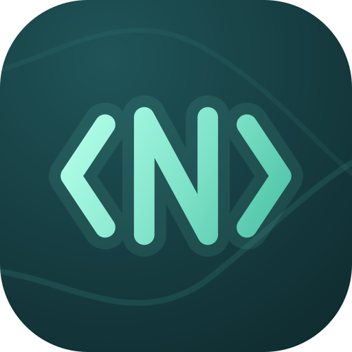

<p align="center">
  
</p>

<h1 align="center">N3-Core</h1>

<p align="center">
  An offline notebook, code editor and PCAP reader for Android.<br>
  Developed by <a href="https://github.com/n0obcoders">Nitin Shukla</a> ·
  <a href="https://n0obcoders.github.io/portfoli0">Portfolio</a>
</p>

---

N3-Core (formerly N३ editor) puts four tools in one private app:

- a Notepad-style **notes editor**
- **code notes**, a **Python editor** and a VS Code-style **code editor**
- an advanced **PCAP / PCAPNG reader** that decodes every packet and shows what it contains

Everything stays on your device. There is no account, no sync server and no analytics.

It pairs with [Packetra](https://github.com/n0obcoders/packetra): captures exported from
Packetra (or Wireshark, tcpdump, PCAPdroid) open in N3-Core, where you can read every packet.

## Download

Get the latest APK from the [Releases](https://github.com/n0obcoders/N3-editor/releases) page,
or build it yourself (see [Building](#building)). It needs Android 8.0 (API 26) or newer.

## Features

### PCAP reader
- Opens `.pcap` and `.pcapng` captures (microsecond and nanosecond timestamps, multiple
  interfaces), parsed entirely on the device.
- A capture summary: format, size, packet count, duration, protocols, top talkers and
  conversations.
- A virtualized packet list that stays smooth with hundreds of thousands of packets.
- **One combined filter**:
  - an **IP** field: exact (`10.0.0.5`), prefix (`10.0.`, `10.0.0.*`) or CIDR (`10.0.0.0/8`);
  - an **Any / TCP / UDP** switch;
  - a **port** or port range (`443`, `8000-8100`).

  Every part you fill in must match. You can also type an expression:

  ```
  ip 10.0.0.5 tcp port 443
  ip.addr==10.0.0.5 && udp.port==53
  src 192.168.1.10 dst port 80
  not dns
  ```
- **Packet inspector** with three tabs:
  - **Details:** every decoded layer and field (Ethernet, Linux SLL, IPv4/IPv6, ARP, TCP,
    UDP, ICMP/ICMPv6, DNS, HTTP, TLS ClientHello with SNI, DHCP, NTP, SSH, QUIC).
  - **Payload:** the packet's application data as readable text.
  - **Hex dump:** offset, hex and ASCII columns.
- **Follow stream:** a whole TCP or UDP conversation, both directions, as text.
- **Export packets as text:** every packet in the current filter goes into one `.txt` report,
  with decoded layers, payload text and hex dump for each, readable in any editor.

### Notes
- Autosave, undo/redo, cut/copy/paste, and an unsaved-changes marker (`*`).
- Notepad-style find and replace: next and previous with wrap-around, match case, whole word
  and regex. Matches are highlighted as you type.
- Word wrap, line numbers, a status bar (line/column, words, characters, reading time), font
  size and family.
- Open any text file, edit it and save it back, keeping its encoding and line endings. Save
  as a new file with any of 24 extensions.
- Note types: plain, rich text, checklist, image, voice, drawing, link and code.
- Colours, pins, archive, trash, templates, version history with diff and restore.
- Search across titles, text, checklists, file names and attachment captions.

### Code editors
- **Python Editor** and **Code Editor** share one core: tabs, a folder explorer, a status bar
  and a command palette.
- Syntax colours for 30 languages, an offline syntax check, auto-indent, auto-close,
  comment toggling, line operations, go to line and snippets.
- Large files (over 1,500 lines or 80,000 characters, up to 32 MB) switch to a line-by-line
  editor that only lays out the lines on screen.

### Privacy and safety
- App lock (fingerprint, face or device PIN) and per-note AES-256-GCM encryption with a key
  in the Android Keystore.
- JSON and ZIP backups to a location you choose. Restore accepts backups from both
  N3-Core and N३ editor, including notes larger than Android's 2 MB cursor window.
- Home-screen widgets and launcher shortcuts.

## What's new in 1.4.0
- Renamed to **N3-Core**, with a new `<N>` logo.
- A welcome page on first launch, an **About the developer** page in the menu, and the
  GitHub repository in Settings.
- Fixed restore failing with "Row too big to fit into CursorWindow" for backups that contain
  a large note.

### 1.3.0
- Search fixes:
  - The search box no longer drops letters.
  - Find bars keep the keyboard focus, and matches are highlighted.
- The keyboard no longer covers the editors.
- Editors lag much less:
  - link detection and word counts run in the background;
  - line numbers are drawn as a single text instead of one item per line;
  - syntax colours no longer redraw the whole file twice per key;
  - undo history has a memory cap.
- PCAP reader: the combined IP + TCP/UDP + port filter, the Payload tab, Follow stream and the
  text export.

See [CHANGELOG.md](CHANGELOG.md) for the full history.

## Building

Requirements: JDK 17 or 21 and the Android SDK (platform 35, build-tools 35). The Gradle
wrapper downloads everything else.

```bash
git clone https://github.com/n0obcoders/N3-editor.git
cd N3-editor
echo "sdk.dir=/path/to/Android/sdk" > local.properties
./gradlew assembleDebug                 # app/build/outputs/apk/debug/app-debug.apk
./gradlew :core:test :app:testDebugUnitTest
```

### Release signing
Release builds read their key from `keystore.properties`, which git ignores; see
`keystore.properties.sample`. You can also set the `NOTEBOOK_KEYSTORE_*` environment
variables. Without either, `assembleRelease` produces an unsigned APK. To create a key, run
`scripts/generate-keystore.sh`.

## Project layout

| Module | What it holds |
| --- | --- |
| `core/` | Pure Kotlin, no Android: models, search, backup format, text tools, syntax highlighter and code checker, the PCAP parser, packet decoder, filter and text export. Unit tested on the JVM. |
| `app/` | The Android app: Jetpack Compose UI, Room database, DataStore settings, Hilt, WorkManager, widgets. |
| `docs/` | Benchmarks, reports and the logo. |

Tech: Kotlin, Jetpack Compose, Material 3, Room, DataStore, Hilt, WorkManager, Glance, Coil.

## About the developer

**Nitin Shukla** builds privacy-first Android tools for people who work with code and networks.

- GitHub: [github.com/n0obcoders](https://github.com/n0obcoders)
- Portfolio: [n0obcoders.github.io/portfoli0](https://n0obcoders.github.io/portfoli0)
- Other projects: [Packetra](https://github.com/n0obcoders/packetra), a network traffic capture
  and inspection app.

## License

MIT. See [LICENSE](LICENSE).
